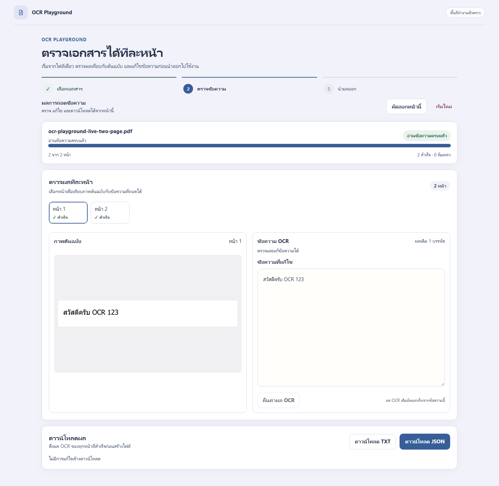
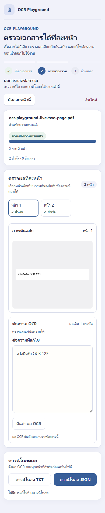

# OCR Playground design system

## Overview

**Selected direction: Paperflow (concept C)**, chosen by the owner on 2026-11-22. It balances a clear OCR workspace with a distinctive but quiet portfolio presentation. The [standalone concept](docs/design/concept-c.html) and its [desktop](docs/design/concept-c-desktop.png) and [mobile](docs/design/concept-c-mobile.png) captures are the visual reference; the Next.js application now implements that direction in the separate frontend project.

The first screen starts the upload immediately. A three-step indicator makes upload, processing and review legible; the review workspace keeps the page image and editable OCR text together and shows page outcomes without relying on color alone.

## Colors

The implemented CSS uses these tokens for its page, surfaces, text, actions and status states. The UI uses colors with text labels so status does not rely on color alone.

| Role | Value |
| --- | --- |
| Page ground | `#f1f2fa` |
| Surface / document paper | `#ffffff` / `#fffefb` |
| Primary text / secondary text | `#252f4b` / `#495675` |
| Primary / hover | `#385e98` / `#2c4e83` |
| Border | `#d8dceb` |
| Success / success ground | `#34644f` / `#e9f3ed` |
| Warning / warning ground | `#79501c` / `#fbf3e5` |
| Error / error ground | `#8b404c` / `#f8ecee` |

## Typography

Use a readable Thai/English sans-serif throughout. The application uses the system stack `Leelawadee UI`, `Tahoma`, `Noto Sans Thai`, `Segoe UI`, then sans-serif without bundling font assets. The reference uses a 15px body with 1.55 line height and a 29–39px main heading. Browser tests cover Thai copy and OCR content.

## Layout

At desktop widths, use a centered shell up to 1440px with 40px side padding in the reference. The upload introduction and drop zone sit side by side; the completed workspace puts the document image and editable text in equal columns. Page thumbnails appear above the workspace, with selected, blank and failed states labeled. The implemented workspace was inspected at 1440×1100 and 390×844 with a synthetic two-page OCR job. See the [desktop](docs/design/implemented-desktop.png) and [mobile](docs/design/implemented-mobile.png) captures.

### Mobile and accessibility

At 780px and below, stack upload content and the image/text panels; allow the page strip to scroll horizontally. At 520px and below, use 14px side padding. Browser checks exercise mobile layout and keyboard navigation. Controls have accessible labels, visible keyboard focus and status text that remains readable without color.

## Elevation, shapes and components

White surfaces, soft lavender grounds and light borders establish hierarchy; reserve shadows for the document preview. The reference uses 14px panel radii, 10px button radii and small pill-shaped status markers. Build project-owned reusable primitives such as button, input, select, textarea, dialog and progress as needed; OCR-specific upload, page selector, viewer and editor compose them.

## States and acceptance

The application implements upload, queued, processing, completed, partial failure, failed, successful blank page, expiry and recovery. A failed page is distinct from a successful blank page. In-memory edits persist across page changes; restore and discard require confirmation; edits can be copied after expiry. See [product requirements](PRODUCT.md) and [frontend plan](docs/frontend-plan.md) for full behavior.

The mockup combines different workflow states in one page to show the design. The application shows the state returned by the backend. File limits, retention and response shapes are defined by the implemented backend contract in [ocr-backend](https://github.com/ADISAK-PORNCHAROEN/ocr-backend/blob/develop/docs/frontend-api.md). A local CPU OCR flow has been exercised through the BFF. Accuracy on a real-document corpus and performance benchmarks have not been measured.

## Implemented captures

These local captures show a synthetic two-page PDF after OCR. The desktop view
uses a 1440px viewport and the mobile view uses a 390px viewport.

