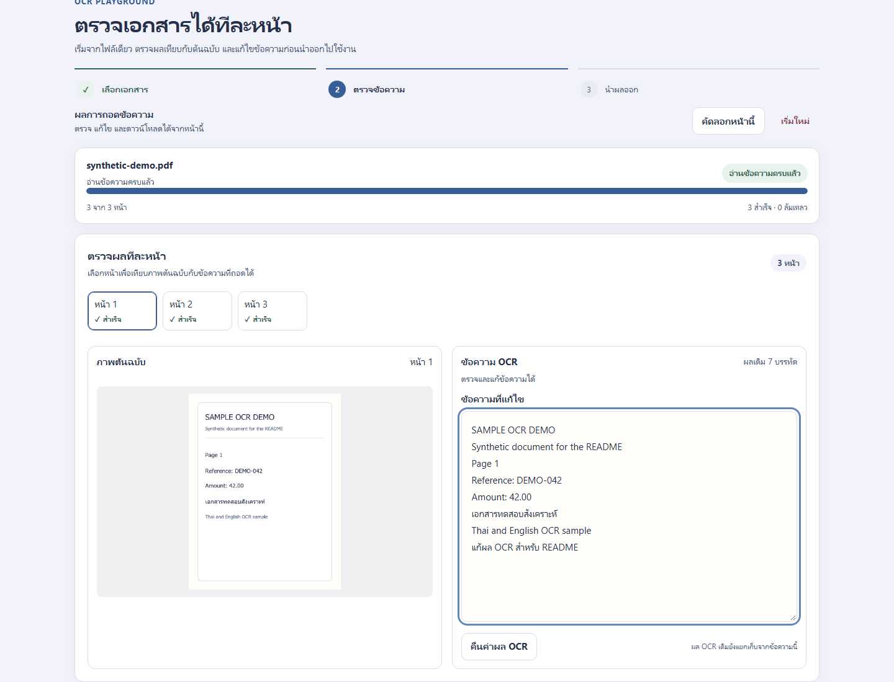
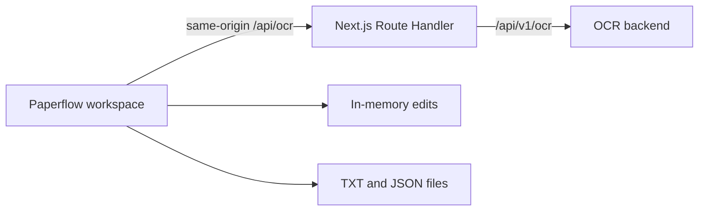

# OCR Playground

OCR Playground is a local web app for printed Thai and English document OCR.
Upload one JPG, PNG, or PDF, compare each page image with its extracted text,
make corrections, and download TXT or JSON. The Thai interface follows the
[Paperflow C design](DESIGN.md) on desktop and mobile.

Next.js serves the interface and forwards requests to the separate
[OCR backend](https://github.com/ADISAK-PORNCHAROEN/ocr-backend).
The backend runs inference. Edits stay in browser memory until you refresh or
close the page, so download your work before leaving.

## Watch the demo



[](https://github.com/user-attachments/assets/8049403e-6c5d-4f7e-b1e9-926783f41a22)

[Download the WebM from this repository](docs/media/ocr-playground-demo.webm).
The 13-second recording is silent; its steps are described here: select a
synthetic three-page PDF, follow progress, correct OCR text, download TXT, and
restart to delete the job through the Next.js BFF.

## Prerequisites

- [Node.js](https://nodejs.org/en/download) 20.9 or newer.
- [pnpm](https://pnpm.io/installation) 11.25.0, as pinned in `package.json`.
- Git to clone both repositories.
- Python 3.13 and [uv](https://docs.astral.sh/uv/getting-started/installation/)
  for the companion backend.
- Internet access to install dependencies and download the backend's model on
  the first OCR request.

Keep both services on loopback for this local, single-user demo. Public or
multi-user deployment needs a revised [security model](docs/SECURITY-MODEL.md).

## Start the backend

Open a terminal for the separate backend repository:

```sh
git clone https://github.com/ADISAK-PORNCHAROEN/ocr-backend.git
cd ocr-backend
uv sync --group dev
uv run uvicorn app.main:app --host 127.0.0.1 --port 8000 --reload --workers 1
```

Use one worker because the backend holds job state in one API process. The first
OCR job can take longer while the model downloads. Open
[backend health](http://127.0.0.1:8000/health) and
[API docs](http://127.0.0.1:8000/docs) to confirm the service is available.

The backend has its own optional `.env.local`. Follow its
[setup instructions](https://github.com/ADISAK-PORNCHAROEN/ocr-backend#run-locally)
for backend settings. The frontend reads current capabilities through the BFF;
resource limits belong to the backend and can change with its configuration.
See the [backend API contract](https://github.com/ADISAK-PORNCHAROEN/ocr-backend/blob/develop/docs/frontend-api.md).

## Start the frontend

Open another terminal and clone this repository:

```sh
git clone https://github.com/ADISAK-PORNCHAROEN/ocr-frontend.git
cd ocr-frontend
pnpm install
```

Copy the frontend environment example. In PowerShell, run:

```powershell
Copy-Item .env.example .env.local
```

On macOS or Linux, run `cp .env.example .env.local`. The example contains:

```dotenv
OCR_BACKEND_URL=http://127.0.0.1:8000
OCR_APP_ORIGINS=http://localhost:3000,http://127.0.0.1:3000
OCR_BACKEND_TIMEOUT_MS=60000
```

`OCR_BACKEND_URL` is server-only configuration. `OCR_APP_ORIGINS` must include
the exact browser origin, including its port, for upload and delete requests.
`OCR_BACKEND_TIMEOUT_MS` bounds each upstream HTTP request, not the full
asynchronous OCR job. Keep `.env.local` out of Git and use `.env.example` for
shared configuration examples.

Start the development server:

```sh
pnpm dev
```

Open [OCR Playground](http://127.0.0.1:3000). To check the full connection, open
[capabilities through the BFF](http://127.0.0.1:3000/api/ocr/capabilities).
Restart the frontend after changing `.env.local`.

## Try the complete flow

Use a document that contains no personal or confidential data:

1. Select or drop one JPG, PNG, or PDF. Press **เริ่มถอดข้อความ** to upload it.
2. Watch the job status and page progress. The app polls while the job is queued
   or processing and opens review when processing ends.
3. Select a page and compare its image with the OCR text. Edit the text, copy it,
   or use **คืนค่าผล OCR** to restore that page after confirmation.
4. Choose **ดาวน์โหลด TXT** or **ดาวน์โหลด JSON**. Export fetches every successful
   page first. JSON keeps edited text separate from original OCR data.
5. Press **เริ่มใหม่** to delete the backend job and return to upload. The app
   asks before discarding edits that you have not downloaded.

Edits survive page changes during the current session. A successful blank page
remains editable; a failed page shows its error. Partial results require export
confirmation, and a failed page fetch prevents an incomplete download.

Refreshing or closing the page loses drafts. If a job expires while the page
stays open, you can copy drafts still in memory. A failed deletion offers retry
or continue, with backend expiry as the cleanup fallback.

## Understand the request flow



The BFF forwards allowed OCR routes, checks the origin for upload and delete,
and handles connection failures. It does not run inference. Zod validates API
responses before the UI uses them. TanStack Query owns backend snapshots and
polling; the OCR session reducer owns page selection and drafts.

## Find the code

The main directories are:

```text
src/
	app/                         App Router page, layout, styles, and providers
		api/ocr/[...segments]/    BFF Route Handler
	components/ui/               Button, card, progress, and textarea
	features/ocr/
		api/                     Fetch client, schemas, and API mapping
		components/              Upload, progress, review, and workspace
		export/                  TXT and JSON serialization
		session/                 In-memory page selection and drafts
		queries.ts               Query keys and polling rules
	lib/server/ocr-backend.ts     BFF configuration and forwarding
tests/
	unit/                        API mapping and export checks
	e2e/                         Browser workflows through the BFF
	fixtures/                    Controllable HTTP backend without OCR
docs/                            Product, architecture, design, and test records
```

Run `rg --files src tests docs` to list current files. Start with
[`OcrWorkspace.tsx`](src/features/ocr/components/OcrWorkspace.tsx) to follow the
session, or read the [architecture guide](docs/ARCHITECTURE.md) for ownership and
request details.

## Run checks

Install Playwright's Chromium before the first browser test:

```sh
pnpm exec playwright install chromium
```

Run commands from the frontend repository. The scripts are defined in
[`package.json`](package.json):

| Command | Purpose |
| --- | --- |
| `pnpm dev` | Run the local development server on port 3000. |
| `pnpm lint` | Run Biome checks on source, tests, and listed configuration files. |
| `pnpm typecheck` | Run TypeScript without emitting files. |
| `pnpm test:unit` | Run Vitest checks. |
| `pnpm test:e2e` | Run Playwright against the HTTP fixture through Next.js. |
| `pnpm test` | Run unit tests followed by E2E tests. |
| `pnpm build` | Create the production build. |
| `pnpm start` | Serve a completed build on loopback port 3000. |
| `pnpm fixture` | Run the fake backend manually on port 4010. |
| `pnpm dev:e2e` | Run Next.js on port 3001 with fixture settings. |

`pnpm test:e2e` starts its own fixture on port 4010 and Next.js on port 3001.
Leave those ports free. You do not need to start either test service manually or
run the real backend for E2E. The fixture returns controlled page data and
**does not run OCR**. These tests check the frontend and BFF, not recognition
accuracy or the companion backend.

See [testing](docs/TESTING.md) for recorded results and the separate live backend
integration. The demo and a live synthetic upload exercise actual inference;
neither establishes accuracy on a real-document corpus.

## Troubleshoot startup

- If the page opens but OCR is unavailable, check backend health, the frontend
  capabilities URL, and `OCR_BACKEND_URL`. Keep the backend terminal running.
- If upload or delete returns `ORIGIN_NOT_ALLOWED`, add the browser's exact
  origin to `OCR_APP_ORIGINS` and restart Next.js.
- If an upload loses its connection before a job ID arrives, check the message
  before retrying. The backend may already have accepted the file, so retries
  require your action.
- If E2E cannot start its servers, stop processes using ports 3001 and 4010.

## Read more

- [Product scope and supported journeys](PRODUCT.md)
- [Product terminology](CONTEXT.md)
- [Frontend specification](docs/spec.md) and [implementation plan](docs/frontend-plan.md)
- [Paperflow C design](DESIGN.md)
- [Architecture](docs/ARCHITECTURE.md)
- [Testing and verification limits](docs/TESTING.md)
- [Security model](docs/SECURITY-MODEL.md)
- [GitHub issues](https://github.com/ADISAK-PORNCHAROEN/ocr-frontend/issues)
