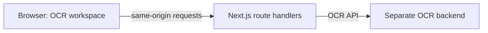

# Architecture

Status: proposed; no application source or executable entry points are present yet. The owner-approved product direction is in [PRODUCT.md](../PRODUCT.md), with details in the [frontend plan](frontend-plan.md). The backend contract is proposed and has not been implemented.

## Intended boundaries

The browser owns in-memory user edits and renders the workspace. Server data and polling are intended for TanStack Query; the OCR session owns selected page and edits separately from original OCR data. Next.js route handlers form a thin BFF that forwards requests and responses, with connection-error handling, to the backend. The backend owns OCR processing, file validation and temporary data cleanup.

The planned application uses Next.js App Router, React, TypeScript, Tailwind CSS, native fetch and boundary validation with Zod. Shared UI primitives are independent of OCR; OCR-specific UI composes them. These are decisions, not claims that dependencies or modules already exist.

## Critical journey

Upload one supported file through the BFF, poll the job to a terminal state, select a page and edit a separate in-memory draft, fetch all successful pages for export, then request deletion on restart or end. Failed pages and successful blank pages are distinct. A missing job must not silently discard copyable in-memory edits.

## Integration and unresolved contract

The separate backend's `frontend-api.md` is a proposal, not an implemented contract. Confirm status/error schemas, limits and expiry, binary images and coordinates, multipart forwarding, cancellation and timeouts before claiming integration. No local native API schema or executable contract test currently exists. Avoid exposing backend wire representations across unrelated modules; validate at the external boundary.
