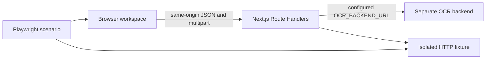

# Frontend architecture

Status: implementation sketch for issues #4–#8. The backend API remains
unimplemented; its proposal is not treated as a verified contract.

## Runtime boundaries



The browser owns the selected page and unsaved edits in memory. TanStack Query
owns backend job, page-list and page-result data. Route Handlers forward the
proposed backend paths and safe response headers; they do not implement OCR or
invent limits. The browser never receives the backend origin. The local fixture
implements the proposed API only for repeatable frontend tests and does not
prove the separate backend follows it.

## Module map

```text
src/
  app/
    api/ocr/jobs/route.ts                       # create a job
    api/ocr/jobs/[jobId]/route.ts               # status and delete
    api/ocr/jobs/[jobId]/pages/route.ts         # page summaries
    api/ocr/jobs/[jobId]/pages/[pageNumber]/route.ts
    api/ocr/jobs/[jobId]/pages/[pageNumber]/image/route.ts
    layout.tsx                                  # Thai document shell and providers
    page.tsx                                    # server entry; workspace composition
  components/ui/                                # project-owned primitives
  features/ocr/
    api/client.ts                               # same-origin fetch and validation
    api/schemas.ts                              # Zod boundary schemas and domain types
    components/                                 # upload, progress, page review, export
    export/serialize.ts                         # pure TXT and JSON serialization
    session/reducer.ts                          # in-memory draft and session transitions
    session/types.ts                            # session state and actions
    queries.ts                                  # query keys, polling and mutations
    workspace.tsx                               # state orchestration and layout
  lib/env.ts                                    # server-only backend origin validation
tests/
  fixtures/ocr-backend.ts                       # isolated HTTP backend for browser tests
  e2e/                                          # externally observable user journeys
  unit/                                         # schemas and serializers
```

Feature code owns OCR-specific behavior. A shared module is added only when a
real second caller needs it. UI primitives stay independent of OCR and are
created with their first use.

## Domain and boundary sketch

```ts
type JobStatus = "queued" | "processing" | "completed" | "partially_completed" | "failed";
type PageStatus = "pending" | "processing" | "completed" | "failed";

type OcrSession = {
  jobId: string;
  currentPage: number | null;
  drafts: Record<number, string>;
  draftRevision: number;
  downloadedRevision: number;
};

type SessionAction =
  | { type: "job-started"; jobId: string }
  | { type: "page-selected"; pageNumber: number }
  | { type: "draft-changed"; pageNumber: number; text: string }
  | { type: "draft-restored"; pageNumber: number }
  | { type: "export-downloaded"; revision: number }
  | { type: "session-ended" };

function sessionReducer(state: OcrSession | null, action: SessionAction): OcrSession | null;
async function createJob(file: File, signal: AbortSignal): Promise<Job>;
async function getJob(jobId: string, signal: AbortSignal): Promise<Job>;
async function getPages(jobId: string, signal: AbortSignal): Promise<PageSummary[]>;
async function getPage(jobId: string, pageNumber: number, signal: AbortSignal): Promise<PageResult>;
async function downloadExport(input: ExportInput): Promise<Blob>;
```

The signatures are a design contract, not implemented functions. Runtime API
data starts as `unknown` and is parsed with Zod at the browser boundary. A draft
entry is checked by key presence, so an intentional empty string differs from
no edit. `draftRevision !== downloadedRevision` means edits remain unsaved.
OCR originals are never overwritten by the reducer.

## Request and state flow

1. The upload control accepts one JPG, PNG or PDF. Browser checks only the
   proposed media types; backend validation remains authoritative. A known
   rejection is shown with its recovery. An uncertain network outcome does not
   retry automatically and requires an explicit user action.
2. After the BFF returns a parsed job ID, the reducer starts that job's session.
   The job query polls every 1.5 seconds only while `queued` or `processing` and
   stops at a terminal status. Query keys include the job ID, so an old request
   cannot update the current job's visible state.
3. Terminal jobs load page summaries. Selecting a successful page loads its
   result and binary image through the BFF. Successful blank and failed pages
   remain separate states; failed pages have no editable OCR result.
4. Text edits update only the in-memory session. Restore is explicit. A
   successful export fetches every successful page before creating a file; a
   failed fetch creates no file. Partial jobs require confirmation. The
   downloaded revision is recorded only after the browser starts the download.
5. End/restart asks before discarding edits, then requests DELETE. A failed
   DELETE offers retry or continue. Expired jobs retain copyable drafts and do
   not offer a completeness-claiming export. Browser navigation uses
   `beforeunload` while edits differ from the last downloaded revision.

## BFF contract

The browser calls only `/api/ocr/jobs...`. The server maps these to the proposed
`/api/v1/ocr/jobs...` paths at the configured backend origin, forwards
multipart and image response bodies, and returns `Cache-Control: no-store`.
Only the required content type is forwarded from the browser. Network failures
return a stable public `BACKEND_UNAVAILABLE` error without upstream details.
Dynamic identifiers are validated/encoded before forming an upstream path.
No request body, OCR text, image, secret or backend response is logged.

## Verification boundary

Vitest covers pure serialization and schema behavior. Playwright drives the
actual Next.js UI while a separate local HTTP fixture receives BFF requests;
this verifies the frontend contract and visible recovery behavior only. Actual
multipart limits, expiry, deletion, image dimensions/coordinates, OCR output,
and E2E behavior remain unverified until the backend exposes its API.
