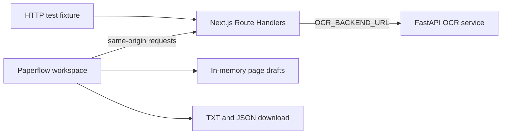

# Frontend architecture

Status: implementation design for Issues #4–#9. Issue #3 remains the product
specification. The backend source now has the proposed routes, but the source is
uncommitted and its runtime has not been verified.

## Runtime boundaries



The browser owns page selection, drafts, and file composition. TanStack Query
owns backend job and page data. Next.js Route Handlers forward requests to the
configured backend. They do not run OCR or define file limits. A local HTTP
fixture drives the same route handlers during browser tests. Fixture results
prove the frontend flow, not the backend implementation.

## Ownership and data shapes

```text
src/
  app/                         # App Router pages and explicit BFF endpoints
  components/ui/               # accessible, OCR-independent primitives
  features/ocr/
    api/                        # schemas, same-origin client and wire mapping
    components/                 # upload, progress, review, editor and export
    export/                     # TXT and JSON serialization
    session/                    # memory-only reducer and selectors
    queries.ts                  # query keys, polling and mutations
    workspace.tsx               # Paperflow composition and session operations
  lib/                          # server-only environment parsing
tests/
  fixtures/                     # separate HTTP backend fixture
  unit/                          # boundary and serialization behavior
  e2e/                           # browser behavior through the BFF
```

Server responses start as `unknown` and are parsed by Zod in the OCR API
boundary. Components receive frontend domain values, not FastAPI field names.
The session reducer owns only the selected page, page drafts and edit revision.
TanStack Query remains the sole owner of server snapshots.

```ts
type PageDetail =
  | { kind: "completed"; number: number; hasText: boolean; original: OriginalOcr }
  | { kind: "failed"; number: number; error: PageError }
  | { kind: "pending" | "processing"; number: number };

type OcrSession = {
  jobId: string;
  selectedPage: number;
  drafts: Readonly<Record<number, string>>;
  revision: number;
  downloadedRevision: number;
};

type SessionAction =
  | { type: "select-page"; pageNumber: number }
  | { type: "edit-page"; pageNumber: number; text: string }
  | { type: "restore-page"; pageNumber: number }
  | { type: "export-downloaded"; revision: number };

function sessionReducer(state: OcrSession, action: SessionAction): OcrSession;
async function createJob(file: File, signal: AbortSignal): Promise<Job>;
async function getJob(jobId: JobId, signal: AbortSignal): Promise<Job>;
async function listPages(jobId: JobId, signal: AbortSignal): Promise<PageIndex>;
async function getPage(jobId: JobId, pageNumber: number, signal: AbortSignal): Promise<PageDetail>;
async function createExport(input: ExportSnapshot, format: ExportFormat): Promise<Blob>;
```

A draft exists when its page key exists, even when its value is `""`. Original
OCR data is immutable. A captured export records its edit revision; later edits
remain unsaved when that older revision is downloaded. A job-keyed React session
and query key keep delayed data from another job out of the current view.

## Backend contract mapping

The older API document is a proposal and differs from the current backend
source. The frontend adapter follows the companion backend's
[job schemas](../../ocr-backend/app/api/schemas/jobs.py) and
[job routes](../../ocr-backend/app/api/controllers/jobs.py) until a committed,
runnable backend contract replaces them.

| Frontend route | Backend route | Purpose |
| --- | --- | --- |
| `/api/ocr/capabilities` | `GET /api/v1/ocr/capabilities` | Current media types and limits |
| `/api/ocr/jobs` | `POST /api/v1/ocr/jobs` | Multipart field `file` |
| `/api/ocr/jobs/{id}` | `GET`, `DELETE /api/v1/ocr/jobs/{id}` | Job status and cleanup |
| `/api/ocr/jobs/{id}/pages` | `GET /api/v1/ocr/jobs/{id}/pages` | Page records, mapped to an index |
| `/api/ocr/jobs/{id}/pages/{number}` | Matching backend page route | Full OCR detail |
| `/api/ocr/jobs/{id}/pages/{number}/image` | Matching backend image route | PNG bytes |

The backend returns `id`, `filename`, `media_type`, snake_case progress, and
ISO timestamps for a job. Page records use `page_number`, `has_text`,
`original_text`, `image_size`, and `image_url`. OCR boxes use `{x1, y1, x2,
y2}`. Errors include `code`, `message`, and `retryable`. The adapter validates
these shapes, maps them once, and constructs image paths from the validated job
and page IDs. It never fetches the backend-provided `image_url` as an arbitrary
target.

The page-list route currently returns full page records. The frontend maps that
response to page statuses. Export still requests each successful page detail,
including pages the user has not opened, before it creates a file.

## Request and session flow

1. The upload form accepts one JPG, PNG, or PDF. Capabilities supplies numeric
   limits when the backend responds; the UI invents none. Backend validation is
   authoritative. Upload mutation retries are disabled. An uncertain outcome
   requires an explicit user action.
2. After a valid job response, a keyed session starts. The job query polls every
   1.5 seconds while status is `queued` or `processing`, then stops. Query keys
   include the job ID.
3. Terminal jobs expose page navigation. A completed blank page stays editable.
   A failed page displays its error and has no OCR editor.
4. Export captures a draft snapshot and fetches all completed page details. A
   failed read or incomplete page set produces no file. Partial results require
   confirmation. TXT names every page. JSON separates edits from original OCR
   text and metadata.
5. Restart and finish warn before discarding unsaved edits, then request DELETE.
   A failed delete offers retry or continue. A missing or expired job keeps the
   in-memory drafts available for copying and disables complete export.
6. Refresh and tab close never persist drafts. `beforeunload` warns when the
   current revision differs from the last downloaded revision. It does not try
   to delete a backend job.

## Architecture decision

Two candidates were scored from one to five against the same criteria.

| Criterion | Candidate A | Candidate B | Reason |
| --- | ---: | ---: | --- |
| Domain invariants | 5 | 5 | Both separate OCR results from memory-only edits and preserve blank-page edits. |
| Stale-request safety | 5 | 4 | A keys the component and queries by job ID and cancels work on unmount. B adds a second generation value beside the job-keyed queries. |
| Ownership boundaries | 5 | 4 | A keeps session state local to one job. B centralizes several domain operations in one controller. |
| Acceptance coverage | 4 | 5 | B spells out uncertainty and decision states more fully. |
| Interface depth | 5 | 4 | A exposes fewer coordination states to UI components. |
| **Total** | **24** | **22** | |

Candidate A uses a keyed session component, reducer, and job-scoped queries.
Candidate B uses one workspace controller with a richer view-state union and
generation tokens. Candidate A is the base because the job ID already scopes
queries and the keyed component; a second generation counter would repeat that
identity. The selected shape keeps component operations tied to one job
lifetime.

The implementation will graft Candidate B's typed workspace decisions and one
session operation controller for export and cleanup. That keeps confirmation,
fetch completeness, and delete recovery out of presentation components. It will
not add a second server cache, actor, or generic operation framework. The
cross-judge step was skipped because every available model belongs to the GPT
family, so no independent model family could review the candidates.

## Execution and verification checkpoints

Issues remain the acceptance checklist. This sequence records implementation
order without restating their criteria.

- [x] Scaffold the app and native checks before feature work.
- [x] Implement the BFF, validated API adapter, and HTTP fixture for #4.
- [ ] Implement upload and terminal polling for #4 and #5.
- [ ] Implement page review and memory-only editing for #6.
- [ ] Implement complete TXT and JSON export for #7.
- [ ] Implement confirmation, DELETE recovery, and expiry behavior for #8.
- [ ] Verify the current real backend against #9 or keep #9 open with evidence.
- [ ] Run the full unit, browser, lint, type, and production-build checks.
- [ ] Open a PR from `develop` and leave it unmerged until the owner asks.

**Throughput checkpoint.** Blocking first steps are the issue audit, backend
schema inspection, branch check, and test-harness setup. The implementation is
one code-coupled workstream, so one owner will serialize changes to the shared
workspace and commit after each issue-sized verification. The backend is a
separate, changing repository and remains read-only here. At each phase, record
the command, observable result, and commit before starting the next issue.

Vitest will cover boundary parsing and serialization. Playwright will exercise
the browser through Next.js and a separate local HTTP fixture. This does not
prove real OCR, PDF coordinates, retention, expiry, or backend cleanup. Those
checks require the current backend source to run in isolated storage.
